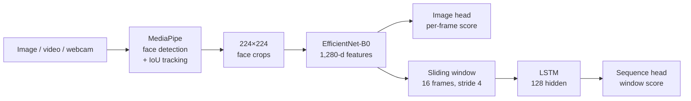

# FrameGuard

**A spatial-temporal deepfake detector for images and video.** A fine-tuned EfficientNet-B0 looks for manipulation artifacts in each face crop, and an LSTM watches how those faces change across a 16-frame window. Everything runs locally: training, inference, and a results dashboard.

## The problem

- **Frame-by-frame detectors ignore time.** Many detectors score each frame on its own, so they cannot see temporal inconsistencies such as flicker, jitter, or unnatural changes between neighbouring frames.
- **Forensic models are heavy.** State-of-the-art detectors are often too slow to inspect video streams or filter uploads on ordinary hardware.
- **Models do not generalise.** A detector trained on one dataset's pixel artifacts often fails on new compression levels, lighting, or generation methods.

FrameGuard tests a simple question: **does a lightweight temporal model on top of a frame-level CNN actually beat averaging the CNN's frame scores?** It reports the answer on both a held-out split and an unseen dataset.

## How it works



- **Images** go through the CNN and its image head only, with one score per detected face.
- **Videos and webcam streams** are sampled at 8 fps. Each face track keeps its own buffer, and once it holds 16 valid frames (about 2 seconds) the LSTM scores the window. A new temporal score is produced every 4 sampled frames.
- **No face means no verdict.** The output is `unable_to_assess`, never "real".
- **Scores are in `[0, 1]`**, higher meaning more evidence of manipulation. Decision thresholds come from validation data. Scores are not calibrated probabilities.
- **Grad-CAM heatmaps** show which face regions drove the CNN's spatial prediction.

```text
Face crops        [B, 16, 3, 224, 224]
CNN features      [B, 16, 1280]
LSTM outputs      [B, 16, 128]
Last time step    [B, 128]
Sequence logit    [B, 1]
```

## Training strategy

Training runs in two stages, so the temporal model can be compared fairly against the spatial model it is built on.

| Stage | What trains | Details |
|---|---|---|
| **A1: Warm-up** (epoch 1) | New image head only | ImageNet EfficientNet-B0 is frozen. AdamW, lr `1e-3` |
| **A2: Fine-tune** (epochs 2–5) | Whole CNN + head | Backbone unfrozen. AdamW, lr `1e-4` |
| **Feature cache** | Nothing | Frozen CNN turns every crop into a 1,280-d vector. The cache is tied to the checkpoint's SHA-256 |
| **B: Temporal** (5 epochs) | LSTM + sequence head | CNN stays frozen. Only unbroken 16-frame windows from a single track are used |

- **Loss:** `BCEWithLogitsLoss` with gradient clipping at 1.0.
- **Sampling:** class-balanced, then video-balanced, so long videos do not dominate.
- **Model selection:** after each epoch, scores are aggregated per video on the validation set. The checkpoint with the best **validation ROC-AUC** is kept, along with its validation-selected threshold.
- **Reproducibility:** every checkpoint stores the seed, manifest hash, training groups, sampler, library versions, and hardware.

## Data

| Partition | Source | Real | Manipulated | Total |
|---|---|---:|---:|---:|
| Train | FaceForensics++ (C23) | 700 | 700 | 1,400 |
| Validation | FaceForensics++ (C23) | 150 | 150 | 300 |
| Internal test | FaceForensics++ (C23) | 150 | 150 | 300 |
| External test | Celeb-DF v2 | 178 | 340 | 518 |

- **FF++ manipulated videos are the Deepfakes method.** FF++ is split 70/15/15 by connected source group (seed 42). An original video and all of its fakes always land in the same partition.
- **Celeb-DF is never used for training or tuning.** It follows the dataset's own test list and measures generalisation to an unseen dataset.
- **Face preparation is complete:** 2,136 videos accepted, 382 rejected (372 with multiple faces, 10 with no usable face), 280,374 face crops. Videos with more than one face are excluded from training, because a video-level label cannot say which face was manipulated.
- Crops are stored as memory-mapped `.npy` arrays, so the training loader can read random frames without decompressing whole videos.

Datasets are **not** included in this repository. Obtain FaceForensics++ and Celeb-DF v2 under their own terms.

## Evaluation

Every test run compares two models on **the same windows**:

| Model | Configuration |
|---|---|
| Spatial baseline | Fine-tuned CNN, frame scores averaged over each window |
| FrameGuard | The same CNN's features plus the trained LSTM |

The report covers ROC-AUC, precision, recall, F1, false-positive rate, confusion matrices, per-video predictions, and excluded videos. FF++ internal results and Celeb-DF external results are reported separately. Metrics are at the video level, not per correlated frame.

## Dashboard

```powershell
python -m frameguard dashboard          # http://127.0.0.1:8765
python -m frameguard dashboard --export # offline snapshot in dashboard/index.html
```

The dashboard needs only the Python standard library. It shows loss and accuracy histories, ROC and precision-recall curves, confusion matrices, score distributions, model comparisons, dataset partitions, per-video predictions, and JSON/SVG export. It refreshes every 15 seconds. Media upload and analysis unlock once trained weights exist. When no results exist, the charts stay empty; it never shows placeholder metrics.

## Run it

Tested with Python 3.13 on Windows (PyTorch, torchvision, OpenCV, MediaPipe, scikit-learn). A CUDA GPU is optional; pass `--device cuda` with a CUDA build of PyTorch.

```powershell
# 1. Environment
python -m venv .venv
.venv\Scripts\python -m pip install -r requirements.txt   # exact versions: requirements.lock.txt

# 2. Model assets: MediaPipe face detector + ImageNet EfficientNet-B0 (hash-checked)
.\setup-training-assets.ps1

# 3. Import datasets and build the leakage-checked manifest
python -m frameguard import-archives data/archive.zip "data/archive (1).zip" data/imported --seed 42

# 4. Detect, track and crop faces (up to 256 sampled frames per video)
python -m frameguard prepare data/imported/manifest.csv data/crops --detector models/blaze_face_short_range.tflite --max-samples 256

# 5. Stage A: spatial CNN
python -m frameguard train spatial data/crops models/spatial.pt --epochs 5 --batch-size 8

# 6. Stage B: cache features, then train the LSTM
python -m frameguard cache-features data/crops models/spatial.pt data/features
python -m frameguard train temporal data/features models/temporal.pt --checkpoint models/spatial.pt --epochs 5

# 7. Evaluate on the internal test split and on Celeb-DF
python -m frameguard evaluate data/features models/temporal.pt runs/ffpp-test.json --split test
python -m frameguard evaluate data/features models/temporal.pt runs/celeb-external.json --split external
```

`scripts/run_experiment.py` runs steps 4–7 as one supervised job. It writes live state to `runs/experiment-status.json` and stops at the first failed stage.

### Inference

```powershell
python -m frameguard predict photo.jpg models/temporal.pt runs/image.jsonl --detector models/blaze_face_short_range.tflite --heatmaps runs/heatmaps
python -m frameguard predict clip.mp4  models/temporal.pt runs/video.jsonl --detector models/blaze_face_short_range.tflite
python -m frameguard predict 0         models/temporal.pt runs/webcam.jsonl --detector models/blaze_face_short_range.tflite --webcam --duration 30
```

Each JSONL record holds per-face boxes, scores, threshold, mode (`spatial` or `temporal`), window start and end, and timing. The webcam is used only when that command is run, and raw webcam video is never saved.

### Tests

```powershell
python -m unittest discover -s tests -v   # 35 tests
node tests/test_charts.cjs                # dashboard chart maths
```

## Project structure

```text
frameguard/
  archives.py    dataset import and leakage-checked splitting
  indexing.py    FF++ / Celeb-DF indexing and manifest merging
  manifest.py    manifest schema and validation
  media.py       decoding and MediaPipe face detection
  temporal.py    IoU face tracking and sliding windows
  prepare.py     face-crop extraction to memory-mapped arrays
  data.py        datasets, balanced sampler, feature caching
  model.py       EfficientNet-B0 + image head + LSTM + sequence head
  train.py       two-stage training and checkpoint selection
  evaluate.py    spatial-vs-temporal comparison on identical windows
  metrics.py     ROC-AUC, PR, F1, FPR, threshold selection
  infer.py       image / video / webcam prediction and Grad-CAM
  dashboard.py   local results server
dashboard/       static HTML/CSS/JS dashboard and chart maths
scripts/         end-to-end experiment runner
tests/           unit tests (Python + Node)
```

## Status

| Step | State |
|---|---|
| Data import, manifests, leakage checks | ✅ Done |
| Face detection, tracking, cropping | ✅ Done (280,374 crops) |
| Code, CLI, dashboard, tests | ✅ Done (35/35 tests passing) |
| Stage A: spatial CNN training | ⏳ Started, no epoch completed yet |
| Stage B: LSTM training | ⏳ Pending |
| Internal and Celeb-DF evaluation | ⏳ Pending |
| Augmentation, calibration, joint fine-tuning, external detector comparison | 🔜 Planned |

**No accuracy numbers are published yet.** This section will be updated with real results once evaluation finishes.

## Honesty notes

- **CNN + LSTM is an established architecture.** The contribution is the trained and evaluated system and its spatial-vs-temporal comparison, not a new architecture.
- **Temporal modelling may not win.** If the LSTM does not beat averaging the CNN's scores, that is a valid result and will be reported as one.
- **The FF++ split is a project split**, not the official benchmark split. Source videos are kept apart across partitions; person identities are not guaranteed to be.
- **Only FF++'s Deepfakes method is used for training**, and multi-face videos are excluded. Results do not cover every manipulation type.
- **Not a universal AI-media detector.** The scope is facial manipulation in video and images.
- **Grad-CAM explains the CNN only.** It is not a pixel-level manipulation mask and does not explain the LSTM's decision.
- **"Real-time" depends on hardware.** Latency has not been benchmarked yet, and no speed claims are made.
