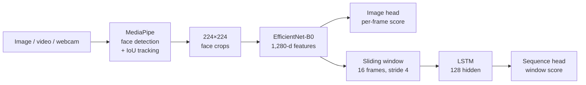

# FrameGuard

**A spatial-temporal deepfake detector for images and video.** A fine-tuned EfficientNet-B0 looks for manipulation artifacts in each face crop, and an LSTM watches how those faces change across a 16-frame window. Everything runs locally: training, inference, and a results dashboard.

## The problem

- **Frame-by-frame detectors ignore time.** Many detectors score each frame on its own, so they cannot see temporal inconsistencies such as flicker, jitter, or unnatural changes between neighbouring frames.
- **Forensic models are heavy.** State-of-the-art detectors are often too slow to inspect video streams or filter uploads on ordinary hardware.
- **Models do not generalise.** A detector trained on one dataset's pixel artifacts often fails on new compression levels, lighting, or generation methods.

FrameGuard tests a simple question: **does a lightweight temporal model on top of a frame-level CNN actually beat averaging the CNN's frame scores?** It reports the answer on a held-out test split pooled from three datasets, per dataset, and on a manipulation method it never saw in training.

## How it works



- **Images** go through the CNN and its image head only, with one score per detected face.
- **Videos and webcam streams** are sampled at 8 fps. Each face track keeps its own buffer, and once it holds 16 valid frames (about 2 seconds) the LSTM scores the window. A new temporal score is produced every 4 sampled frames.
- **No face means no verdict.** The output is `unable_to_assess`, never "real".
- **Scores are in `[0, 1]`**, higher meaning more evidence of manipulation. Decision thresholds come from validation data. Scores are not calibrated probabilities.
- **Grad-CAM heatmaps** show which face regions drove the CNN's spatial prediction.

```text
Face crops        [B, 16, 3, 224, 224]
CNN features      [B, 16, 1280]
LSTM outputs      [B, 16, 128]
Last time step    [B, 128]
Sequence logit    [B, 1]
```

## Training strategy

Training runs in two stages, so the temporal model can be compared fairly against the spatial model it is built on.

| Stage | What trains | Details |
|---|---|---|
| **A1: Warm-up** (epoch 1) | New image head only | ImageNet EfficientNet-B0 is frozen. AdamW, lr `1e-3` |
| **A2: Fine-tune** (epochs 2–5) | Whole CNN + head | Backbone unfrozen. AdamW, lr `1e-4` |
| **Feature cache** | Nothing | Frozen CNN turns every crop into a 1,280-d vector. The cache is tied to the checkpoint's SHA-256 |
| **B: Temporal** (5 epochs) | LSTM + sequence head | CNN stays frozen. Only unbroken 16-frame windows from a single track are used |

- **Loss:** `BCEWithLogitsLoss` with gradient clipping at 1.0.
- **Sampling:** every (dataset, class) pair gets an equal share of draws, then videos are balanced, so no dataset, class or long video dominates.
- **Augmentation (Run 2):** random flips, rescaling, blur, colour shifts and JPEG re-compression on training crops, to resist re-encoded and screenshot-style media.
- **Model selection:** after each epoch, scores are aggregated per video on the validation set. The checkpoint with the best **validation ROC-AUC** is kept, along with its validation-selected threshold.
- **Reproducibility:** every checkpoint stores the seed, manifest hash, training groups, sampler, library versions, and hardware.

## Data

The current model (Run 2) is trained on a pooled dataset. Each dataset is split 70/15/15 by connected groups (seed 42), balanced per class:

| Dataset | Grouped by | Train (real / fake) | Validation | Test |
|---|---|---:|---:|---:|
| FaceForensics++ C23: real + Deepfakes, Face2Face, FaceSwap, NeuralTextures | Source video | 700 / 2,800 | 150 / 600 | 150 / 600 |
| FF++ FaceShifter (**never trained on**) | Source video | – | – | 0 / 150 |
| Celeb-DF v2: all real, 2,500 sampled fakes | Celebrity identity | 623 / 1,872 | 134 / 322 | 133 / 306 |
| DFDC parts 00–09: 2,512 real, each with one of its fakes | Original video | 1,758 / 1,758 | 377 / 377 | 377 / 377 |

- **No leakage across splits:** an original video and all of its fakes, and every video of a Celeb-DF identity, land in the same split. DFDC publishes no actor IDs, so the same actor can still appear in two different DFDC originals.
- **Face preparation:** 64 frames per video at 8 fps. 10,971 of 13,564 videos accepted. The rest had more than one face, no usable face (often small or distant faces in DFDC), or no continuous 16-frame window. Multi-face videos are excluded because a video-level label cannot say which face was manipulated.
- **Excluded:** FF++ DeepFakeDetection, because its real videos are not in the dataset.
- Crops are stored as memory-mapped `.npy` arrays, so the training loader can read random frames without decompressing whole videos.
- **Run 1** (archived) used FF++ real + Deepfakes only (2,000 videos, 256 frames each), with Celeb-DF's 518-video test list kept as an unseen dataset.

Datasets are **not** included in this repository. Obtain FaceForensics++, Celeb-DF v2 and DFDC under their own terms; see [Add the datasets](#2-add-the-datasets) for the expected ZIP layout.

## Evaluation

Every test run compares two models on **the same windows**:

| Model | Configuration |
|---|---|
| Spatial baseline | Fine-tuned CNN, frame scores averaged over each window |
| FrameGuard | The same CNN's features plus the trained LSTM |

The report covers ROC-AUC, precision, recall, F1, false-positive rate, confusion matrices, per-video predictions, and excluded videos. Results are reported for all datasets together, per dataset, per FF++ manipulation method, and for the unseen method separately (its fakes never count towards the totals). Metrics are at the video level, not per correlated frame.

## Dashboard

```powershell
python -m frameguard dashboard          # http://127.0.0.1:8765
python -m frameguard dashboard --export # offline snapshot in dashboard/index.html
```

The dashboard needs only the Python standard library. It shows loss and accuracy histories, ROC and precision-recall curves, confusion matrices, score distributions, model comparisons, dataset partitions, per-video predictions, and JSON/SVG export. It refreshes every 15 seconds, and the overview compares in-domain and unseen-dataset results side by side. When no results exist, the charts stay empty; it never shows placeholder metrics.

**Analyse media** unlocks once trained weights exist. Upload a JPG, PNG or MP4 and it returns a verdict scored exactly like the evaluation: the mean of every LSTM window score over the same number of sampled frames the model was evaluated with (64 frames, about 8 s, for the current model), compared with the validation-selected threshold. It also shows per-face scores and a timeline of window scores against the threshold. On held-out videos, the dashboard's scores match the evaluation report's scores exactly.

## Run it

There are two ways to train from scratch:

| | Where | Rough time | You need |
|---|---|---|---|
| **A. Kaggle, mixed datasets (recommended)** | Free Kaggle GPU (T4) | ~3.7 h (measured on a T4) | A phone-verified Kaggle account |
| **B. Local, original FF++ Deepfakes protocol** | Your Windows PC | ~4–7 h on an NVIDIA GPU, 2–3 days on a laptop CPU | ~80 GB free disk, the dataset ZIPs |

### A. Train on Kaggle (mixed datasets)

This run trains for generalisation. It pools three datasets into one leakage-checked split, adds training augmentation, and keeps one manipulation method out of training to test it as unseen:

| Dataset (Kaggle) | Used | Role |
|---|---|---|
| `xdxd003/ff-c23` (FaceForensics++ C23) | 1,000 real; Deepfakes, Face2Face, FaceSwap, NeuralTextures | Train / val / test |
| | FaceShifter (test-group fakes only) | **Unseen-method test** |
| `reubensuju/celeb-df-v2` (Celeb-DF v2) | all 890 real, 2,500 sampled fakes | Train / val / test |
| `pranay22077/dfdc-10` (DFDC parts 00–09) | 3,000 sampled real videos, each with one of its fakes | Train / val / test |

- **Split:** 70/15/15 per dataset by connected groups, balanced per class. FF++ is grouped by source video, Celeb-DF by celebrity identity, and DFDC by original video. DFDC has no actor IDs, so the same actor can still appear in two different original videos.
- **Excluded:** FF++ DeepFakeDetection, because its real videos are not in the dataset.
- **Training changes:**
  - 64 frames per video (~8 s)
  - JPEG/blur/rescale/colour/flip augmentation
  - sampling balanced across datasets and classes
  - parallel face preparation
- **Report:** results overall, per dataset and per FF++ method go to `runs/mixed-test.json`.

1. On [kaggle.com](https://www.kaggle.com), create a notebook and import [`kaggle/frameguard-kaggle.ipynb`](kaggle/frameguard-kaggle.ipynb) (*File → Import Notebook*).
2. *Add Input*: the three datasets above. They are mounted directly, so nothing has to be downloaded or uploaded.
3. *Settings*: **Accelerator → GPU T4**, **Internet → On**.
4. **Save Version → Save & Run All (Commit)**. The run continues with the browser closed (12-hour limit). Face preparation prints an ETA every 25 videos (it took 2 h 22 min in Run 2).
5. When it finishes, download `frameguard-results.zip` from the version's **Output** tab and unzip it into your local project to view the results in the dashboard.

The original single-method run (FF++ Deepfakes only, Celeb-DF test list as an unseen dataset) is still available. Run `scripts/run_experiment.py` without `--dfdc`; that is what produced the results in [Status](#status).

### B. Train locally

Windows 10/11. An NVIDIA GPU is optional but strongly recommended: on a laptop CPU, one spatial epoch takes about 4 hours.

#### 1. Set up the environment (one command)

```powershell
git clone https://github.com/khakash-060206/FrameGuard.git
cd FrameGuard
powershell -ExecutionPolicy Bypass -File .\setup.ps1
```

`setup.ps1` does everything on a fresh machine:

- installs Python 3.13 for the current user with winget if it is missing
- creates `.venv`
- installs a **CUDA build of PyTorch if an NVIDIA GPU is detected**, otherwise the CPU build
- installs all other packages at the exact versions in `requirements.lock.txt`
- downloads the MediaPipe face detector and ImageNet EfficientNet-B0 weights and checks their SHA-256 hashes
- verifies imports, the GPU, and a model forward pass, then runs the unit tests

Options: `-Cpu` forces the CPU build, `-CudaIndex cu130` picks another CUDA wheel index (the default `cu126` needs NVIDIA driver 528 or newer), and `-SkipTests` skips the tests.

#### 2. Add the datasets

Put two ZIP files in `data/`:

| File | Contents FrameGuard reads | Size |
|---|---|---|
| `data/archive.zip` | FaceForensics++ C23: `FaceForensics++_C23/original/*.mp4` and `FaceForensics++_C23/Deepfakes/*.mp4` (other folders are ignored) | ~17.9 GB |
| `data/archive (1).zip` | Celeb-DF v2: `List_of_testing_videos.txt` at the ZIP root, plus `Celeb-real/`, `Celeb-synthesis/`, `YouTube-real/` | ~10.0 GB |

Other locations work with `--ffpp` and `--celeb`, which also accept already-extracted folders (used in place, without copying). Allow about **80 GB of free disk**: 28 GB of ZIPs, 4.5 GB of extracted videos, 40 GB of face crops, plus features.

The train/validation/test split is rebuilt from the ZIP contents with seed 42. `splits/reference-split.csv` records the split from the original run, and the runner stops if the new split differs, which usually means a different dataset version.

#### 3. Run the full experiment

```powershell
.\.venv\Scripts\python.exe scripts\run_experiment.py --device auto
```

This runs every stage in order: import → verify split → face crops → spatial CNN → feature cache → LSTM → internal and Celeb-DF evaluation. Live state is in `runs/experiment-status.json`, and the runner stops at the first failed stage. Keep the laptop plugged in and awake: checkpoints are only saved at the end of each epoch.

| Option | Default | What it does |
|---|---|---|
| `--device auto\|cuda\|cpu` | `auto` | Where to train |
| `--epochs N` | 5 | Epochs for each training stage |
| `--batch-size N` | 8 | Use 32 on a GPU |
| `--frames-per-video N` | all crops | Spatial training draws N crops per video per epoch instead of every crop (~140 per video). `32` makes each epoch ~4× shorter |
| `--workers N` | 0 | Parallel data-loading processes; `4` keeps a GPU busy |
| `--amp auto\|on\|off` | `auto` | float16 mixed precision, on by default for CUDA |
| `--max-samples N` | 256 | Frames sampled per video during face preparation |
| `--data-dir PATH` | `data` | Where imported videos, crops and features go |
| `--resume` | off | Skip stages already marked completed in `runs/experiment-status.json` |

Fast GPU run: `--device cuda --batch-size 32 --frames-per-video 32 --workers 4`.

Results land in `models/spatial.pt`, `models/temporal.pt` (with `.history.json` training logs) and `runs/ffpp-test.json`, `runs/celeb-external.json`. Open them with `python -m frameguard dashboard`.

### Running stages by hand

```powershell
# Import datasets and build the leakage-checked manifest
python -m frameguard import-archives data/archive.zip "data/archive (1).zip" data/imported --seed 42

# Detect, track and crop faces (up to 256 sampled frames per video)
python -m frameguard prepare data/imported/manifest.csv data/crops --detector models/blaze_face_short_range.tflite --max-samples 256

# Stage A: spatial CNN
python -m frameguard train spatial data/crops models/spatial.pt --epochs 5 --batch-size 8

# Stage B: cache features, then train the LSTM
python -m frameguard cache-features data/crops models/spatial.pt data/features
python -m frameguard train temporal data/features models/temporal.pt --checkpoint models/spatial.pt --epochs 5

# Evaluate on the internal test split and on Celeb-DF
python -m frameguard evaluate data/features models/temporal.pt runs/ffpp-test.json --split test
python -m frameguard evaluate data/features models/temporal.pt runs/celeb-external.json --split external
```

Add `--device cuda` to `train`, `cache-features` and `evaluate` to use the GPU. `train` also accepts `--frames-per-video`, `--workers` and `--amp`. `import-archives` accepts ZIPs or extracted folders.

### Inference

```powershell
python -m frameguard predict photo.jpg models/temporal.pt runs/image.jsonl --detector models/blaze_face_short_range.tflite --heatmaps runs/heatmaps
python -m frameguard predict clip.mp4  models/temporal.pt runs/video.jsonl --detector models/blaze_face_short_range.tflite
python -m frameguard predict 0         models/temporal.pt runs/webcam.jsonl --detector models/blaze_face_short_range.tflite --webcam --duration 30
```

Each JSONL record holds per-face boxes, scores, threshold, mode (`spatial` or `temporal`), window start and end, and timing. The webcam is used only when that command is run, and raw webcam video is never saved.

### Tests

```powershell
python -m unittest discover -s tests -v   # 44 tests
node tests/test_charts.cjs                # dashboard chart maths
```

## Project structure

```text
frameguard/
  archives.py    dataset import (ZIP or folder) and leakage-checked splitting
  assets.py      download and hash-check the pretrained assets
  indexing.py    FF++ / Celeb-DF indexing and manifest merging
  manifest.py    manifest schema and validation
  media.py       decoding and MediaPipe face detection
  temporal.py    IoU face tracking and sliding windows
  prepare.py     face-crop extraction to memory-mapped arrays
  data.py        datasets, balanced sampler, feature caching
  model.py       EfficientNet-B0 + image head + LSTM + sequence head
  train.py       two-stage training and checkpoint selection
  evaluate.py    spatial-vs-temporal comparison on identical windows
  metrics.py     ROC-AUC, PR, F1, FPR, threshold selection
  infer.py       image / video / webcam prediction and Grad-CAM
  dashboard.py   local results server
dashboard/       static HTML/CSS/JS dashboard and chart maths
scripts/         end-to-end experiment runner (run_experiment.py)
splits/          reference train/val/test split from the original run
kaggle/          ready-to-run Kaggle GPU notebook
setup.ps1        one-step environment setup for a fresh Windows machine
tests/           unit tests (Python + Node)
```

## Status

| Step | State |
|---|---|
| Data import, manifests, leakage checks | ✅ Done |
| Face detection, tracking, cropping | ✅ Done (280,374 crops) |
| Code, CLI, dashboard, tests | ✅ Done (44/44 tests passing) |
| Run 1: FF++ Deepfakes only, Celeb-DF as unseen dataset | ✅ Done (archived) |
| Run 2: mixed datasets (FF++ 4 methods + Celeb-DF + DFDC, augmentation, unseen FaceShifter test) | ✅ Done (**current model**) |
| Calibration, joint fine-tuning, external detector comparison, distant-face detection | 🔜 Planned |

### Results: Run 2, mixed datasets (current model)

Kaggle Tesla T4, about 3 h 40 min end to end (face preparation took 2 h 22 min).
- **Data:** 13,564 videos pooled (FF++ 5,150, Celeb-DF 3,390, DFDC 5,024); 10,971 passed face preparation.
- **Settings:** 64 frames per video, 5 epochs per stage, batch 32, 16 augmented crops per training video per epoch, mixed precision.
- **Checkpoints:** best validation AUC at spatial epoch 4 (0.978) and LSTM epoch 1 (0.988).
- **Metrics:** video level, with one threshold selected on the pooled validation split.

| Test group | Videos | ROC-AUC | Accuracy | F1 | Precision | Recall | False-positive rate |
|---|---|---|---|---|---|---|---|
| **All datasets** | 1,327 | **0.989** | **94.7%** | **0.962** | 0.978 | 0.947 | 0.052 |
| FaceForensics++ (4 trained methods) | 649 | 0.985 | 95.5% | 0.972 | 0.977 | 0.967 | 0.092 |
| Celeb-DF v2 | 403 | 0.988 | 92.3% | 0.943 | 0.977 | 0.911 | 0.049 |
| DFDC | 275 | 0.994 | 96.4% | 0.964 | 0.985 | 0.943 | 0.015 |
| FF++ Deepfakes / Face2Face / FaceSwap / NeuralTextures | ~260 each | 0.997 / 0.993 / 0.994 / 0.957 | | | | 1.00 / 0.99 / 1.00 / 0.88 | 0.092 |
| **FF++ FaceShifter (unseen method)** | 260 | **0.641** | 56.5% | 0.339 | 0.707 | 0.223 | 0.092 |

CNN + LSTM shown; the CNN-only baseline scores AUC 0.987 / F1 0.944 overall (all groups are in `runs/mixed-test.json` and the dashboard).

- **On the kinds of fakes it was trained on, it generalises across datasets.** Celeb-DF went from AUC 0.715 / recall 18% (unseen, Run 1) to 0.988 / 91% once its data was in training. The two numbers are not a like-for-like comparison: in Run 2 Celeb-DF is in-domain, with different identities in test.
- **A genuinely new manipulation method is still mostly missed.** FaceShifter was never trained on: AUC 0.64, only 22% caught. This is the honest measure of generalisation to an unseen deepfake tool.
- **The LSTM helps on the pooled test** (F1 0.944 → 0.962, Celeb-DF recall 84% → 91%).
- **About 1 in 11 real FF++ videos is flagged** (false-positive rate 9.2%); real DFDC and Celeb-DF videos are flagged less often (1.5% and 4.9%).
- **Coverage gap:** 636 of 2,093 test videos could not be scored. Most were DFDC (479 of 754): faces too small or distant for the short-range face detector, more than one face, or no continuous 16-frame window. The dashboard says "unable to assess" for such media.

### Results: Run 1, FF++ Deepfakes only (archived)

Full from-scratch run on a Kaggle Tesla T4: 256 sampled frames per video, 5 epochs per stage, batch 32, 32 crops per training video per epoch, mixed precision. It took about 2 hours, and the split matched `splits/reference-split.csv` exactly. Video-level metrics; thresholds were selected on FF++ validation data only. Its checkpoints and reports are kept locally under `runs/archive/run1-ffpp-deepfakes/`.

| Model | Test set | Videos | ROC-AUC | F1 | Precision | Recall | False-positive rate |
|---|---|---|---|---|---|---|---|
| CNN baseline | FF++ internal test | 231 | 0.998 | 0.983 | 0.991 | 0.974 | 0.009 |
| **CNN + LSTM** | FF++ internal test | 231 | **0.999** | **0.987** | 0.991 | 0.983 | 0.009 |
| CNN baseline | Celeb-DF v2 (unseen) | 453 | 0.684 | 0.099 | 0.800 | 0.053 | 0.027 |
| **CNN + LSTM** | Celeb-DF v2 (unseen) | 453 | **0.715** | **0.293** | 0.883 | 0.176 | 0.046 |

- **In-domain, the problem is close to solved.** Both models separate FF++ Deepfakes almost perfectly; validation AUC reached 1.0 by spatial epoch 2.
- **The LSTM helps**, most on the unseen dataset (AUC +0.03, F1 0.10 → 0.29).
- **Generalisation is the open problem.** On Celeb-DF the scores still rank fakes above real videos (AUC 0.72), but at the FF++ threshold only 18% of fakes are caught. A "real" verdict on media from an unseen generator is weak evidence.
- 69 FF++ test videos and 65 Celeb-DF videos were not scored: they were rejected during face preparation (no usable face, or more than one face) or had no continuous 16-frame window.

## Honesty notes

- **CNN + LSTM is an established architecture.** The contribution is the trained and evaluated system and its spatial-vs-temporal comparison, not a new architecture.
- **Temporal modelling may not win.** If the LSTM does not beat averaging the CNN's scores, that is a valid result and will be reported as one.
- **The FF++ split is a project split**, not the official benchmark split. Source videos are kept apart across partitions; person identities are not guaranteed to be.
- **Only FF++'s Deepfakes method is used for training**, and multi-face videos are excluded. Results do not cover every manipulation type.
- **Not a universal AI-media detector.** The scope is facial manipulation in video and images.
- **Grad-CAM explains the CNN only.** It is not a pixel-level manipulation mask and does not explain the LSTM's decision.
- **"Real-time" depends on hardware.** Latency has not been benchmarked yet, and no speed claims are made.
